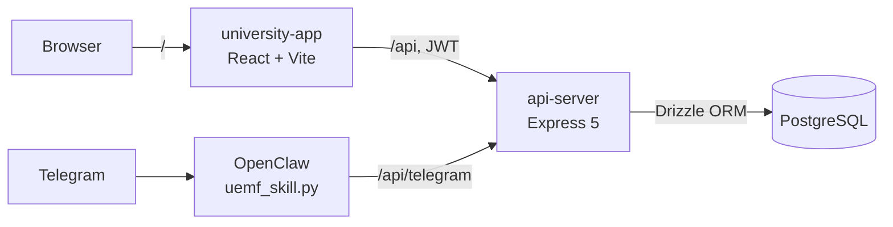

<div align="center">

# UEMF University Management

A university management platform for the Euro-Mediterranean University of Fes.<br />
Students, faculty, courses, grades, schedules, exams, fees and announcements, with a dedicated space for each role.


<sub>End-of-semester project · EIDIA, Euro-Mediterranean University of Fes</sub>

[**Live demo**](http://5.189.141.148:3000/) &nbsp;·&nbsp; [Screenshots](#screenshots) &nbsp;·&nbsp; [Getting started](#getting-started) &nbsp;·&nbsp; [Architecture](#architecture)

<br />


</div>

## Overview

The platform brings a university's academic and administrative work into one web application. Every user signs in with a role (administrator, administration staff, teacher or student) and only sees the pages and data that concern them. A Telegram bot connected to the same API lets students check their schedule, absences and progress without opening the site.

## Features

| Module | Admin | Administration | Teacher | Student |
|---|:---:|:---:|:---:|:---:|
| Dashboard with statistics and charts | ✅ | ✅ | ✅ personal | ✅ personal |
| Students (list, profile, search) | ✅ | ✅ | ✅ own students | |
| Courses and enrollments | ✅ | ✅ | ✅ own courses | ✅ own courses |
| Faculty and departments | ✅ | ✅ | ✅ | |
| Grades | ✅ | ✅ | ✅ entry, own courses | ✅ own grades |
| Schedules and exams | ✅ | ✅ | ✅ | ✅ |
| Tuition fees | ✅ | ✅ | | ✅ own fees |
| Announcements | ✅ | ✅ | ✅ | ✅ |

**Under the hood**

- **Role-based access control, enforced twice**: a `requireRole` middleware on every API route, and protected routes in the interface.
- **Per-user data scoping**: teachers only see students enrolled in their courses, and students only see their own courses, grades and fees (`scopeFilter.ts`).
- **JWT authentication**, with passwords hashed using bcrypt.
- **Contract-first API**: an OpenAPI 3.0 spec generates the React Query hooks and Zod schemas (Orval), shared by client and server.
- **Telegram bot through OpenClaw**: accounts are linked with a one-time token, then students use `/today`, `/week`, `/absence` and `/progress`.

## Screenshots

<sub>Taken from a local instance filled with the demo data from the seed scripts.</sub>

### Sign-in


### Administration

<table>
  <tr>
    <td width="50%"><p align="center"><b>Students</b></p></td>
    <td width="50%"><p align="center"><b>Student profile</b></p></td>
  </tr>
  <tr>
    <td><p align="center"><b>Courses</b></p></td>
    <td><p align="center"><b>Faculty</b></p></td>
  </tr>
  <tr>
    <td><p align="center"><b>Departments</b></p></td>
    <td><p align="center"><b>Enrollments</b></p></td>
  </tr>
  <tr>
    <td><p align="center"><b>Grades</b></p></td>
    <td><p align="center"><b>Schedules</b></p></td>
  </tr>
  <tr>
    <td><p align="center"><b>Exams</b></p></td>
    <td><p align="center"><b>Tuition fees</b></p></td>
  </tr>
  <tr>
    <td><p align="center"><b>Announcements</b></p></td>
    <td><p align="center"><b>Dashboard</b></p></td>
  </tr>
</table>

### Teacher and student spaces

<table>
  <tr>
    <td width="50%"><p align="center"><b>Teacher dashboard</b></p></td>
    <td width="50%"><p align="center"><b>Student dashboard</b></p></td>
  </tr>
  <tr>
    <td colspan="2"><p align="center"><b>Student schedule</b></p></td>
  </tr>
</table>

## Architecture

A pnpm monorepo built around a single OpenAPI spec:

```
UEMF-University-Management/
├── artifacts/
│   ├── university-app/     # React + Vite frontend (pages, layout, auth context)
│   └── api-server/         # Express 5 API: one route file per module, JWT, RBAC, Telegram routes
├── lib/
│   ├── api-spec/           # openapi.yaml and Orval config
│   ├── api-client-react/   # Generated React Query hooks
│   ├── api-zod/            # Generated Zod schemas
│   └── db/                 # Drizzle ORM schema and SQL migration
└── scripts/                # Migration, demo data, OpenClaw skill for the Telegram bot
```



## Tech stack

| Area | Technologies |
|---|---|
| Frontend | React 19, Vite 7, TypeScript, Tailwind CSS 4, shadcn/ui, Recharts, TanStack Query, wouter, react-hook-form |
| Backend | Node.js, Express 5, JWT, bcrypt, pino |
| Data | PostgreSQL, Drizzle ORM, Zod |
| API contract | OpenAPI 3.0, Orval (generates hooks and schemas) |
| Integrations | Telegram bot through OpenClaw |
| Deployment | VPS, PM2, Nginx |

## Getting started

**Requirements**: Node.js 20+, pnpm, PostgreSQL.

```bash
# 1. Dependencies
pnpm install

# 2. Database and demo data
createdb uemf
export DATABASE_URL=postgresql://postgres@localhost:5432/uemf
psql "$DATABASE_URL" -f lib/db/drizzle/0000_premium_norrin_radd.sql
node scripts/run-migration.mjs
node scripts/seed-data.mjs
node scripts/seed-users.mjs
node scripts/seed-telegram-data.mjs   # optional: absences and progress

# 3. API (port 8080)
PORT=8080 SESSION_SECRET=change-me pnpm --filter @workspace/api-server run dev

# 4. Frontend (port 22006, in a second terminal)
PORT=22006 BASE_PATH=/ pnpm --filter @workspace/university-app run dev
```

Then open http://localhost:22006. The Vite dev server forwards `/api` to port 8080. On Windows, `start.ps1` starts PostgreSQL, the API and the frontend in one go once you set the `$projectRoot` path.

### Demo accounts

| Role | Username | Password |
|---|---|---|
| Administrator | `admin` | `admin123` |
| Administration | `administration` | `admin456` |
| Teacher | `teacher` | `teacher123` |
| Student | `student` | `student123` |

## Deployment

The live version runs on a VPS: PM2 manages the API and the frontend behind Nginx, with PostgreSQL on the same machine. The Telegram bot goes through OpenClaw, which calls the API's `/api/telegram/*` routes.

## Team

Yassine Aitaouicha, Haytam Hannoun, Douaa Bahaja and Hamza El Mourabit.

---

<div align="center"><sub>Part of <a href="https://github.com/creepout777">Yassine Aitaouicha's projects</a></sub></div>
